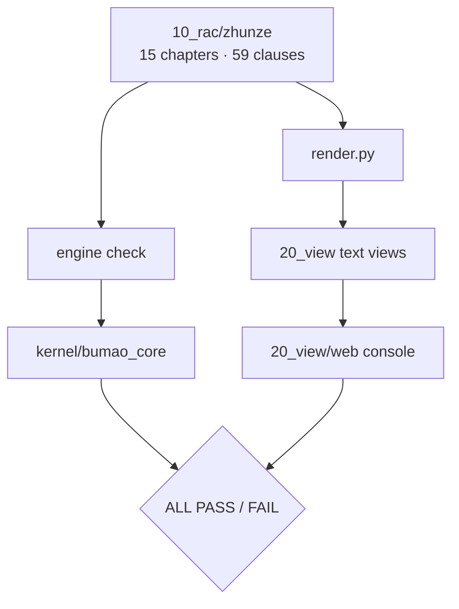
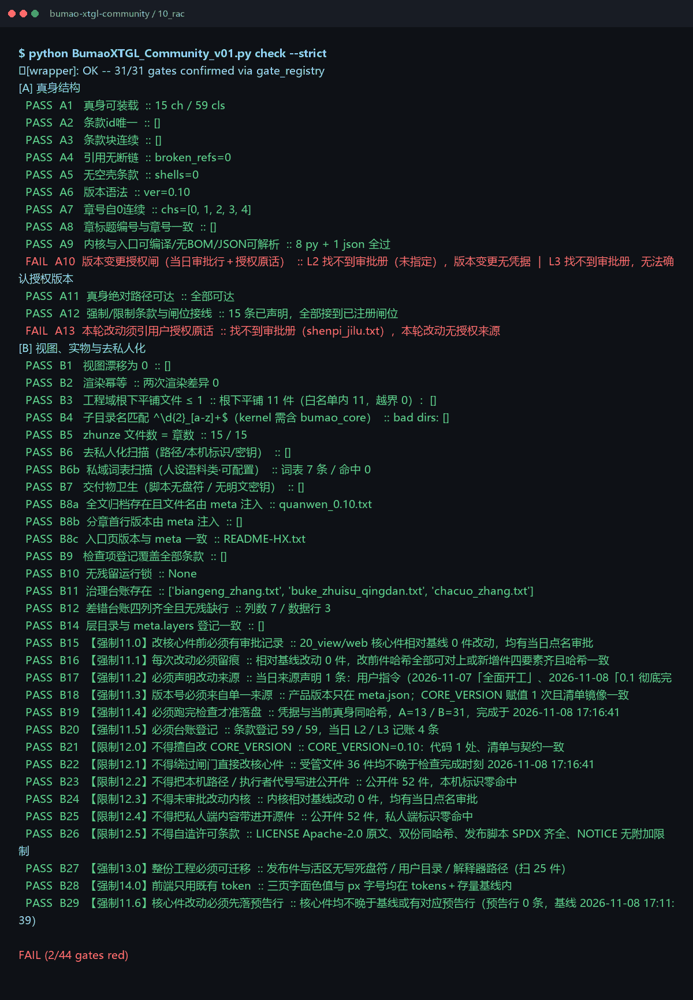

# Bumao XTGL · Community

Status: maintenance pause
状态：维护暂停，稳定可用

> **Maintenance pause** — this line is written in every release. Which release counts as the final paused one is not decided yet, so releases continue at irregular intervals.
> **维护暂停** — 这一行每版照写。哪一版才算最终暂停版尚未确定，因此仍按不定时更新发布。


> **Two version spaces** — the in-app version in `00_meta/meta.json` is `0.35`; the repository release tag is `v0.23`. They are two independent numbering spaces, not the same number.
> **两个版本空间** — 应用内版本（`00_meta/meta.json`）是 `0.35`；仓库发布 tag 是 `v0.23`。这是两个独立的编号空间，不是同一个数字。
>
> **Cold start** — to resume iteration, start from [`RETURN_HERE.md`](RETURN_HERE.md).
> **冷启动** — 恢复迭代从 [`RETURN_HERE.md`](RETURN_HERE.md) 开始。

59 rules, 44 checks and a local web console: run an AI agent under a rule set you can inspect, with one verifiable `ALL PASS` / `FAIL` verdict per run.

**What it is** — the full edition: rule set, gate set and a local console.
**Who it's for** — individuals and small teams that need auditable AI usage.
**What it solves** — after the fact nobody can tell what the agent did or whether it was allowed; before the fact nothing stops it.


*Real console on a single-repo clone: metadata and the gate entry point. The gate-state panel reads sibling editions, so it shows "data unavailable" when only this repo is cloned — a known layout limitation, not a mock. No mock data.*

## Quick start (30 seconds)

```bash
git clone -b v0.23 https://github.com/Bumao-Ai/Bumao-xtgl-community.git
cd Bumao-xtgl-community/10_rac
python BumaoXTGL_Community_v01.py whoami
python BumaoXTGL_Community_v01.py check --strict   # exit code is the verdict
```

Console:

```bash
cd ../20_view/web
python serve.py            # prints the real local address
```

`v0.23` is the tag this README was released with; see Releases and verify the zip with `SHA256SUMS`.

> Counting: **59 rules / 44 checks** are two dimensions. Rules are the written clauses (15 chapters); checks are the gates that inspect them. One rule can be covered by several gates, and one gate can span several rules.

## Proof of work

| Item | Value | Source |
|---|---|---|
| Commits at `v0.23` | — | 远端由 API 合成提交，本地与远端计数不同，不虚标 |
| Last commit | 2026-11-09 | `git log -1 --date=short` |
| Rules | 59 clauses / 15 chapters | first line of `check --strict` (`15 ch / 59 cls`) |
| Check items | 44 | `check --strict` conclusion line (`0/44 gates red` at tag `v0.23`, second run) |
| Reverse cases | 17 | `10_rac/test_qiangzhi.py`; last run 17 caught / 0 missed |
| Defect ledger | 0 real closed items | `30_taizhang/chacuo_zhang.txt` holds 3 sanitized sample rows only |
| Releases | 15 tags, `v0.1` → `v0.23`, 2026-11-08 → 2026-11-09 | `git tag` |
| Changelog | [CHANGELOG.md](CHANGELOG.md) | — |

`A10` passes when the shipped `30_taizhang/shenpi_jilu.txt` carries a same-day authorized entry; this edition ships eight entries dated 2026-11-09. On a clean clone the **first** run flags `B19`/`B22`, because the check credential (`30_taizhang/check_last.json`) is written at the end of that run; run `check --strict` twice — the second run at tag `v0.23` is `0/44` red. That credential is runtime state, not a committed file; the package documents this two-run procedure.

## 中文

- **是什么**：带规则与控制台的完整发行版。
- **给谁用**：需要「可审计地使用 AI」的个人或小团队。
- **解决什么**：AI 干了什么、合不合规，事后查不清、事前拦不住。

快速开始沿用上方命令块。`59 条规则 / 44 道检查` 是两个维度：规则条数指 15 章里的条款总数，检查项数指闸门总数；一条规则可能被多道闸门覆盖，一道闸门也可能横跨多条规则。每条结论挂到证据锚点；本期不新增票链面板。

## Roadmap (0.2 — in progress)

1. **Pre-execution constraint** — state the intent before acting; the kernel rules first. *Replayed on all three live editions on 2026-11-09: no order → reject, expired order → reject, out-of-scope target → reject, compliant order → pass (5/5 cases per edition). The supervisor is not bundled with this repository, so package behaviour stays `off`.*
2. **Mid-execution supervision** — check while the work runs, not once at the end. *Action-level records (`op_id` / target / result) and the mid-sequence halt bundle were replayed on all three live editions on 2026-11-09. A bypass of the entry is recorded as post-hoc searchable only, never counted as covered.*
3. **Post-hoc audit** — link operation, basis, result and exception into one traceable chain. *One command exports the full chain from any `op_id` on all three live editions (2026-11-09); `rule_id` / `run_id` / `error_code` sit on the ticket face.*

Status: **in progress**。设计与沙盒原型已通；2026-11-09 三项已在维护者活区三端复跑。随包不附监督执行器，本仓保持 `off`，本节不声称已随包交付。

## Architecture



## What gets checked


*Real gate-by-gate output on a fresh clone; the last line is the verdict and the exit code.*

| Group | Gates | What it proves |
|---|---|---|
| Rule source | A1–A9, A11, A12 | 15 chapters / 59 clauses load, IDs are unique, blocks are contiguous, references resolve, no empty clauses |
| Authorization trail | A10, A13 | approval ledger and quoted authorization; without a ledger → explicit **DENY** (FAIL), not a waiver |
| Views and render | B1, B2, B5, B8a, B8b, B8c | view drift is zero, render is idempotent, chapter files match, version is injected from meta |
| Structure and layout | B3, B4, B14 | flat root files ≤ 1, sub-directory naming, layers match `meta.layers` |
| Sanitization | B6, B6b, B7, B23, B25 | no machine paths, keys, private words or real ledger entries |
| Coverage, locks, ledgers | B9, B10, B11, B12 | every clause is registered, no stale lock, governance and defect ledgers are complete |
| Governance | B15–B22, B24, B26, B29 | approval before core edits, trace, source, single version source, no fake-green |
| Portability and UI | B27, B28 | the tree is portable; the console uses existing tokens |

Total: 13 source gates + 31 view/governance gates = **44 checks**.

Each run ends with one verdict, and that verdict is anchored to an evidence record (证据锚点) in the console. This release adds no separate ticket-chain view.

## Layout

```
00_meta/      meta.json, gates_decl.json
10_rac/       engine entry, rule sources (zhunze/), renderers
20_view/      generated views + web console + screens/ (README images)
30_taizhang/  ledgers and baselines
40_renwu/     task records
90_lishi/     history
kernel/       bundled bumao_core
```

`30_taizhang/core_baseline.json` is keyed by repository-relative paths, so a fresh clone can verify without a local work tree.

## Docs / License

- Changelog: [`CHANGELOG.md`](CHANGELOG.md)
- Contributing: [`CONTRIBUTING.md`](CONTRIBUTING.md) · DCO: [`DCO`](DCO)
- Security: [`SECURITY.md`](SECURITY.md)
- License: Apache-2.0, see [`LICENSE`](LICENSE)
- Trademark boundary: [`TRADEMARK.md`](TRADEMARK.md)

Copyright 2026 Bumao

---

# Bumao XTGL · Community（中文）

状态：维护暂停，稳定可用


> **两个版本空间** — 应用内版本（`00_meta/meta.json`）是 `0.35`；仓库发布 tag 是 `v0.23`。这是两个独立的编号空间，不是同一个数字。
>
> **冷启动** — 恢复迭代从 [`RETURN_HERE.md`](RETURN_HERE.md) 开始。

59 条规则、44 道检查，加一个本地 Web 控制台：让 AI 代理跑在一套你能逐条看到的规则下，每次运行给出一个可核验的 `ALL PASS` / `FAIL` 结论。

**是什么** — 完整发行版：规则集、闸门集与本地控制台。
**给谁用** — 需要「可审计地使用 AI」的个人或小团队。
**解决什么** — AI 干了什么、合不合规，事后查不清、事前拦不住。


*单仓克隆下的真实控制台：元信息与闸门入口。闸门状态面板会读取同级其他端，所以只克隆本仓时显示「数据不可用」——这是已知的布局限制，不是模拟数据。*

## 快速开始（30 秒）

```bash
git clone -b v0.23 https://github.com/Bumao-Ai/Bumao-xtgl-community.git
cd Bumao-xtgl-community/10_rac
python BumaoXTGL_Community_v01.py whoami
python BumaoXTGL_Community_v01.py check --strict   # 退出码即结论
```

控制台：

```bash
cd ../20_view/web
python serve.py            # 打印真实的本地地址
```

`v0.23` 是本 README 随附发布的 tag；见 Releases，并用 `SHA256SUMS` 校验 zip。

> 计数口径：**59 条规则 / 44 道检查**是两个维度。规则是写下来的条款（15 章）；检查是审视这些条款的闸门。一条规则可能被多道闸门覆盖，一道闸门也可能横跨多条规则。

## 工作留痕

| 项 | 实测值 | 取值来源 |
|---|---|---|
| `v0.23` 处的提交数 | — | 远端由 API 合成提交，本地与远端计数不同，不虚标 |
| 最近提交 | 2026-11-09 | `git log -1 --date=short` |
| 规则 | 59 条 / 15 章 | `check --strict` 首行（`15 ch / 59 cls`） |
| 检查项 | 44 | `check --strict` 结论行（`0/44 gates red`，`v0.23` 处第二次运行） |
| 反向用例 | 17 | `10_rac/test_qiangzhi.py`；最近一次 17 全部捕获 / 0 漏判 |
| 缺陷台账 | 0 条真实闭环 | `30_taizhang/chacuo_zhang.txt` 仅 3 行脱敏样例 |
| 发布 | 15 个 tag，`v0.1` → `v0.23`，2026-11-08 → 2026-11-09 | `git tag` |
| 变更记录 | [CHANGELOG.md](CHANGELOG.md) | — |

`A10` 的通过条件是随包 `30_taizhang/shenpi_jilu.txt` 里有当日的授权条目；本版随附 8 条 2026-11-09 条目。干净克隆上的**第一次**运行会带出 `B19`/`B22`，因为检查凭据（`30_taizhang/check_last.json`）是在那次运行末尾写入的；连跑两次 `check --strict` 即可，`v0.23` 处的第二次运行是 `0/44` 红。该凭据是运行时状态，不是提交文件；包内说明已写明这两步流程。

## Roadmap（0.2 — 进行中）

1. **执行前约束** — 动手前提交意图，由内核先判。*2026-11-09 在维护者活区三端复跑：无单→拒、过期单→拒、出界目标→拒、合规单→放行，每端 5/5 用例全过。随包不附监督执行器，本仓行为保持 `off`。*
2. **执行中监管** — 过程中持续检查，而不是只在结束时判一次。*动作级记录（`op_id`／目标／结果）与中途打断包已于 2026-11-09 在三端复跑；绕过入口只记为「仅事后可查」，不计入已覆盖。*
3. **执行后审计** — 把操作、依据、结果、异常四者关联成一条可追溯链。*任一 `op_id` 一条命令导出完整链路（2026-11-09 三端复跑）；`rule_id`／`run_id`／`error_code` 落在票面。*

状态：**进行中**。设计与沙盒原型已通；2026-11-09 三项已在维护者活区三端复跑。随包不附监督执行器，本仓保持 `off`，本节不声称已随包交付。

## 架构

（图示沿用上方 mermaid 流程：`10_rac/zhunze`（15 章 · 59 条）→ engine check／`render.py` → 文本视图与控制台；engine → `kernel/bumao_core` → `ALL PASS` / `FAIL`。）

## 检查什么


*全新克隆上的真实逐闸门输出；最后一行是结论与退出码。*

| 组 | 闸门 | 证明了什么 |
|---|---|---|
| 规则源 | A1–A9、A11、A12 | 15 章 / 59 条可加载、ID 唯一、块连续、引用可解析、无空条款 |
| 授权链 | A10、A13 | 审批台账与引用式授权；无台账 → 显式 **DENY**（FAIL），不是豁免 |
| 视图与渲染 | B1、B2、B5、B8a、B8b、B8c | 视图零漂移、渲染幂等、章文件一致、版本由 meta 注入 |
| 结构与布局 | B3、B4、B14 | 根文件平铺 ≤ 1、子目录命名、分层与 `meta.layers` 一致 |
| 脱敏 | B6、B6b、B7、B23、B25 | 无机器路径、密钥、私有词或真实台账条目 |
| 覆盖、锁、台账 | B9、B10、B11、B12 | 每条条款均已登记、无陈旧锁、治理与缺陷台账完整 |
| 治理 | B15–B22、B24、B26、B29 | 核心改动前审批、留痕、来源、单一版本源、不许假绿 |
| 可移植与界面 | B27、B28 | 树可移植；控制台只用既有视觉令牌 |

合计：13 道源闸门 + 31 道视图／治理闸门 = **44 道检查**。

每次运行以一个结论收尾，该结论挂到控制台里的证据锚点。本版不新增独立的票链视图。

## 目录

```text
00_meta/      meta.json、gates_decl.json
10_rac/       引擎入口、规则源（zhunze/）、渲染器
20_view/      生成的视图 + Web 控制台 + screens/（README 用图）
30_taizhang/  台账与基线
40_renwu/     任务记录
90_lishi/     历史
kernel/       随包 bumao_core
```

`30_taizhang/core_baseline.json` 以仓库相对路径为键，所以全新克隆无需本地工作树即可校验。

## 文档与许可

- 变更记录：[`CHANGELOG.md`](CHANGELOG.md)
- 参与贡献：[`CONTRIBUTING.md`](CONTRIBUTING.md) · DCO：[`DCO`](DCO)
- 安全策略：[`SECURITY.md`](SECURITY.md)
- 许可：Apache-2.0，见 [`LICENSE`](LICENSE)
- 商标边界：[`TRADEMARK.md`](TRADEMARK.md)

Copyright 2026 Bumao
