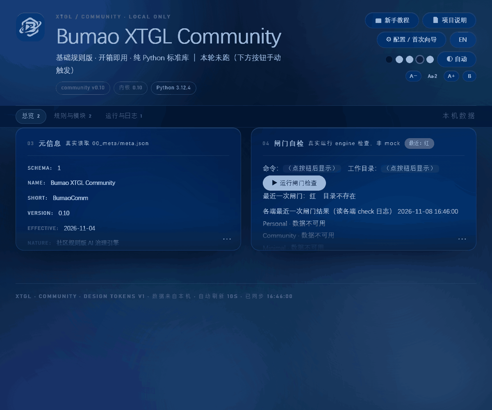
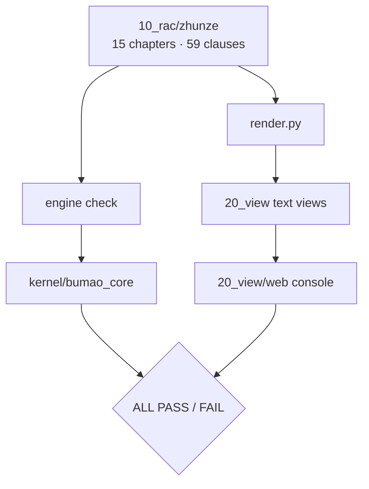
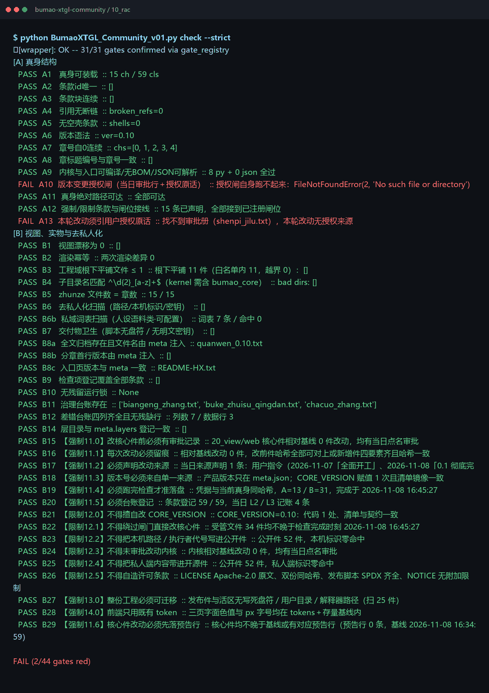

# Bumao XTGL · Community


59 rules, 44 checks and a local web console: run an AI agent under a rule set you can inspect, with one verifiable `ALL PASS` / `FAIL` verdict per run.

**What it is** — the full edition: rule set, gate set and a local console.
**Who it's for** — individuals and small teams that need auditable AI usage.
**What it solves** — after the fact nobody can tell what the agent did or whether it was allowed; before the fact nothing stops it.


*Real console on a fresh clone: metadata and the gate entry point. No mock data.*

## Quick start (30 seconds)

```bash
git clone -b <release-tag> https://github.com/Bumao-Ai/Bumao-xtgl-community.git
cd Bumao-xtgl-community/10_rac
python BumaoXTGL_Community_v01.py whoami
python BumaoXTGL_Community_v01.py check --strict   # exit code is the verdict
```

Console:

```bash
cd ../20_view/web
python serve.py            # prints the real local address
```

`<release-tag>` is the tag of the release you install; see Releases and verify with `SHA256SUMS`.

> Counting: **59 rules / 44 checks** are two dimensions. Rules are the written clauses (15 chapters); checks are the gates that inspect them. One rule can be covered by several gates, and one gate can span several rules.

## Proof of work

| Item | Value | Source |
|---|---|---|
| Commits at `v0.13` | 12 | `git rev-list --count v0.13` |
| Last commit | 2026-11-08 | `git log -1 --date=short` |
| Rules | 59 clauses / 15 chapters | first line of `check --strict` (`15 ch / 59 cls`) |
| Check items | 44 | `check --strict` conclusion line (`2/44 gates red`) |
| Reverse cases | 14 | `10_rac/test_qiangzhi.py`; last run 13 caught / 1 missed (B15) |
| Defect ledger | 0 real closed items | `30_taizhang/chacuo_zhang.txt` holds 3 sanitized sample rows only |
| Releases | 5 tags, `v0.1` → `v0.13`, all 2026-11-08 | `git tag` |
| Changelog | [CHANGELOG.md](CHANGELOG.md) | — |

The two red gates on a fresh public clone are `A10` and `A13` (authorization ledger and quoted approval). They are marked *not applicable* in the public edition, because no real approval samples are shipped.

## 中文

- **是什么**：带规则与控制台的完整发行版。
- **给谁用**：需要「可审计地使用 AI」的个人或小团队。
- **解决什么**：AI 干了什么、合不合规，事后查不清、事前拦不住。

快速开始沿用上方命令块。`59 条规则 / 44 道检查` 是两个维度：规则条数指 15 章里的条款总数，检查项数指闸门总数；一条规则可能被多道闸门覆盖，一道闸门也可能横跨多条规则。

## Roadmap (0.2 — in progress)

1. **执行前约束** — 动手前提交意图，由内核先判。
2. **执行中监管** — 过程中持续检查，而不是只在结束时判一次。
3. **执行后审计** — 把操作、依据、结果、异常四者关联成一条可追溯链。

Status: **in progress**. Nothing here is claimed as shipped.

## Architecture



## What gets checked


*Real gate-by-gate output on a fresh clone; the last line is the verdict and the exit code.*

| Group | Gates | What it proves |
|---|---|---|
| Rule source | A1–A9, A11, A12 | 15 chapters / 59 clauses load, IDs are unique, blocks are contiguous, references resolve, no empty clauses |
| Authorization trail | A10, A13 | approval ledger and quoted authorization; **not applicable** in the public repo |
| Views and render | B1, B2, B5, B8a, B8b, B8c | view drift is zero, render is idempotent, chapter files match, version is injected from meta |
| Structure and layout | B3, B4, B14 | flat root files ≤ 1, sub-directory naming, layers match `meta.layers` |
| Sanitization | B6, B6b, B7, B23, B25 | no machine paths, keys, private words or real ledger entries |
| Coverage, locks, ledgers | B9, B10, B11, B12 | every clause is registered, no stale lock, governance and defect ledgers are complete |
| Governance | B15–B22, B24, B26, B29 | approval before core edits, trace, source, single version source, no fake-green |
| Portability and UI | B27, B28 | the tree is portable; the console uses existing tokens |

Total: 13 source gates + 31 view/governance gates = **44 checks**.

## Layout

```
00_meta/      meta.json, gates_decl.json
10_rac/       engine entry, rule sources (zhunze/), renderers
20_view/      generated views + web console
30_taizhang/  ledgers and baselines
40_renwu/     task records
90_lishi/     history
kernel/       bundled bumao_core
assets/       logos
docs/screens/ screenshots used in this README
```

`30_taizhang/core_baseline.json` is keyed by repository-relative paths, so a fresh clone can verify without a local work tree.

## Docs / License

- Changelog: [`CHANGELOG.md`](CHANGELOG.md)
- Contributing: [`CONTRIBUTING.md`](CONTRIBUTING.md) · DCO: [`DCO`](DCO)
- Security: [`SECURITY.md`](SECURITY.md)
- License: Apache-2.0, see [`LICENSE`](LICENSE)
- Trademark boundary: [`TRADEMARK.md`](TRADEMARK.md)

Copyright 2026 Bumao
